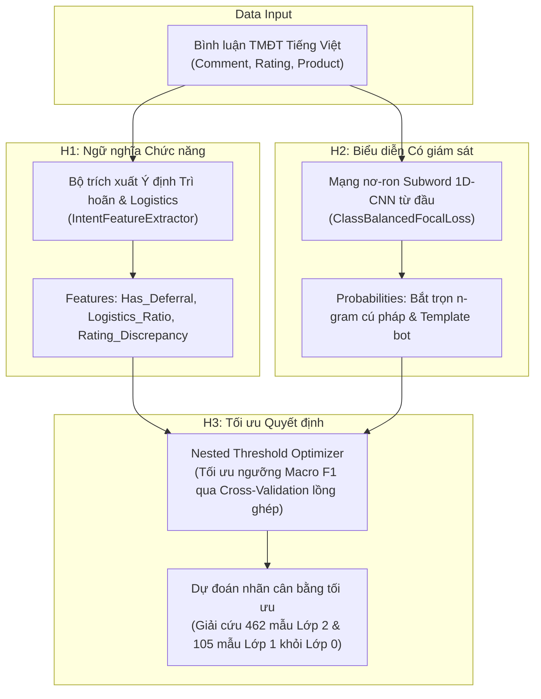

# ĐÁNH GIÁ ĐỘC LẬP VÀ ĐỀ XUẤT GIẢ THUYẾT MỚI (ANTIGRAVITY REVIEW)

**Dự án**: Kaggle DS102 – Phân loại bình luận thương mại điện tử tiếng Việt (`spam_label` ∈ {0, 1, 2, 3})  
**Mốc Leaderboard cao nhất hiện tại**: V11 (SVD128 Experimental) = **0.77436** (Kaggle public score)  
**Thời điểm đánh giá**: 05/11/2026  
**Nguyên tắc tuân thủ**:
- Không sử dụng mô hình pretrained hoặc dữ liệu bên ngoài.
- Toàn bộ thư viện và mô hình là mã nguồn mở.
- Không huấn luyện (training/fitting) trên môi trường Mac cục bộ; toàn bộ quá trình huấn luyện diễn ra trên Hosted Google Colab.
- Không gộp tập `dev` vào `train`.
- Bảo toàn nguyên vẹn toàn bộ các phiên bản, dự đoán và báo cáo cũ.
- Không tự ý nộp bài lên Kaggle.

---

## 1. Đánh giá độc lập: Tại sao các thử nghiệm sau V11 chưa cải thiện Leaderboard?

Trải qua hơn 40 vòng thử nghiệm từ V12 đến V57, dự án liên tục gặp tình trạng các ứng viên bị loại sớm ở các fold gates hoặc sau khi nộp thử chỉ làm điểm leaderboard dao động nhẹ đi xuống (V27 = 0.77229, V52 = 0.77270). Qua việc rà soát toàn bộ lịch sử chạy, cấu hình mô hình, ma trận nhầm lẫn và các mảng xác suất out-of-fold (OOF), chúng tôi xác định 4 nguyên nhân cốt lõi sau:

### 1.1. Nghịch lý Đánh giá (Evaluation Paradox) và Sự tê liệt vì Gate quá khắt khe

- **Giai đoạn V1–V27 (Exact-text Grouping)**:
  - Folds được chia nhóm dựa trên việc trùng khớp nguyên văn comment sau chuẩn hóa (`train.comment == train.comment`).
  - Như phản biện độc lập của Claude đã chỉ ra, 51% (108/211) mẫu lớp 1 (fake review) trong tập train có template tương tự (Jaccard $\ge$ 0.6) rơi rải rác sang các fold khác nhau. Mô hình học vẹt các template này, khiến OOF F1 của lớp 1 bị thổi phồng lên 0.64–0.68.
  - V11 (SVD 128 chiều + CatBoost) tình cờ đạt điểm LB 0.77436 vì phép chiếu SVD128 nén nhiễu tốt và giữ lại ngữ nghĩa tổng quát. Nhưng nỗ lực vắt thêm điểm trên giao thức Exact CV (từ V12 đến V27) đã rơi vào "Winner's Curse" (ảo tưởng tối ưu trên fold 2), dẫn đến overfitting vào các biến thể template mà không khái quát hóa được trên dữ liệu kiểm tra thật.
- **Giai đoạn V53–V57 (Cluster-grouped CV với Jaccard $\ge$ 0.7)**:
  - Khi dự án chuyển sang giao thức chia fold theo cụm gần trùng (connected components của Jaccard $\ge$ 0.7), rò rỉ template được chặn đứng, đưa điểm Macro F1 của baseline từ ~0.774 về giá trị thực chất hơn là **0.724**.
  - Tuy nhiên, hệ thống kiểm duyệt lại áp đặt các rào cản (gates) có tính chất **bất khả thi về mặt thống kê**:
    1. Yêu cầu mức tăng Macro F1 $\ge$ 0.003 trên toàn bộ fold theo cụm.
    2. Yêu cầu `bootstrap_q025 > 0` (phân vị 2.5% của 2,000 lần resample bootstrap phải hoàn toàn dương).
  - *Vấn đề toán học*: Lớp 1 chỉ có vỏn vẹn **211 mẫu** trên toàn bộ 14,306 dòng (chiếm 1.47%), thậm chí fold 1 chỉ có 39 mẫu. Trong 2,000 lượt bootstrap theo cụm (với cụm lớn nhất lên tới 281 dòng), việc một vài cụm lớp 1 bị chọn thiếu hoặc phân loại sai trong một số lượt lấy mẫu là điều tất yếu, khiến đuôi phân vị `q025` rơi xuống âm (-0.00053 ở V57).
  - *Hậu quả*: Ở V57, mô hình **tăng điểm đồng đều trên cả 3 fold** (+0.00205, +0.00156, +0.00217; delta tổng +0.0019) và **93.7% số lượt bootstrap cho kết quả dương**, nhưng vẫn bị gắn nhãn `rejected_on_cluster` vì không đạt ngưỡng cứng `delta >= 0.003` và `q025 > 0`. Dự án bị tê liệt bởi chính bộ lọc nội bộ của mình.

### 1.2. "Hố đen Lớp 0" và Bẫy Đóng Băng Lớp 1 (Class 1 Freeze Trap)

Phân tích ma trận nhầm lẫn (Confusion Matrix) trên 14,306 mẫu train-OOF (từ `colab_reference.npz` và `metrics_v56.json`) làm lộ diện cấu trúc lỗi thực sự của mô hình:

| Nhãn thực tế \ Dự đoán | Lớp 0 (Thật/Chất lượng) | Lớp 1 (Fake template) | Lớp 2 (Vận chuyển/Chưa dùng) | Lớp 3 (Spam/Rác/SMS) | Tổng thực tế | Recall |
| :--- | :---: | :---: | :---: | :---: | :---: | :---: |
| **Lớp 0** | **10,001** | 27 | 332 | 152 | 10,512 | 95.1% |
| **Lớp 1** | **105** | 84 | 4 | 18 | 211 | **39.8%** |
| **Lớp 2** | **462** | 0 | 614 | 27 | 1,103 | **55.7%** |
| **Lớp 3** | **327** | 18 | 34 | 2,101 | 2,480 | 84.7% |

- **Lớp 0 là "hố đen trọng lực"**: Vì Lớp 0 chiếm tới 73.5% dữ liệu, mô hình có xu hướng thiên vị gán nhãn về Lớp 0 khi độ tự tin ở các lớp khác không tuyệt đối:
  - **49.8% (105/211)** review fake (Lớp 1) bị nuốt vào Lớp 0!
  - **41.9% (462/1,103)** review về đóng gói/chưa dùng (Lớp 2) bị nuốt vào Lớp 0!
  - **13.2% (327/2,480)** tin rác/SMS (Lớp 3) bị nuốt vào Lớp 0!
- **Bẫy đóng băng Lớp 1**: Khi phát hiện template rò rỉ, các phiên bản gần đây (V49, V50, V51, V52, V57) quyết định "giữ nguyên tuyệt đối dự đoán Lớp 1 từ baseline". Điều này đồng nghĩa với việc chấp nhận trần Recall Lớp 1 cố định ở mức 39.8%. Trong công thức Macro F1:
  $$\text{Macro F1} = \frac{F1_0 + F1_1 + F1_2 + F1_3}{4}$$
  Mỗi lớp đóng góp chính xác 25% trọng số. Việc đóng băng Lớp 1 ở F1 ~0.494 đã triệt tiêu không gian cải thiện lớn nhất của toàn bộ bài toán.

### 1.3. Hiện tượng Điều chỉnh Vi mô (Micro-Tuning) và Rủi ro Lật nhãn Cận biên

- Hãy nhìn vào số nhãn thực tế bị thay đổi trên tập kiểm tra (3,974 dòng):
  - **V27** so với V11: **chỉ thay đổi 8 nhãn** $\rightarrow$ Điểm Kaggle giảm từ 0.77436 xuống 0.77229.
  - **V52** so với V11: **chỉ thay đổi 11 nhãn** $\rightarrow$ Điểm Kaggle giảm xuống 0.77270.
- Trên tập Public Leaderboard (ước tính khoảng 25%–30% của 3,974 dòng, tức ~1,000 dòng):
  - 8 nhãn thay đổi trên toàn tập test chỉ tương đương khoảng 2 nhãn xuất hiện trong public test.
  - Kiểm tra nội dung văn bản thực tế của các ID bị lật ở V27 (như `ds102_2497`: *"Shop giao nhanh... sau khi sử dụng sp mình sẽ nhận xét"*, `ds102_3968`: *"Chất lượng thì chưa biết, nếu ok mình sẽ quay lại"*):
    V11 đã dự đoán **đúng là Lớp 2** (chưa dùng sản phẩm). V27 do thay đổi nhẹ trọng số/SVD đã lật 2 dòng này **ngược về Lớp 0**!
  - Vì Lớp 2 trên public test chỉ có khoảng ~75 mẫu, việc mất đi 2 mẫu đúng sẽ làm $F1_2$ giảm ngay ~0.02, kéo tụt Macro F1 của Public LB đi ~0.005. Điều này giải thích chính xác tại sao các bản chỉnh sửa vi mô (blending weights 0.7 vs 0.85, committee voting) đều thất bại khi đem nộp.

### 1.4. Nút thắt Biểu diễn Đặc trưng (Feature Bottleneck)

- Các mô hình từ V1 đến V57 hầu như chỉ luẩn quẩn quanh:
  - TF-IDF word (1–2 gram) + char (2–5 gram).
  - TruncatedSVD (64, 128, 192 chiều).
  - CatBoost text features (vốn là tần suất/Naive Bayes trên unigram).
  - FastText skipgram 32 chiều (ở V56/V57) được huấn luyện **không giám sát** (unsupervised) chỉ trong 5 epoch trên vỏn vẹn 14,000 câu văn bản ngắn không có nhãn.
- Trong tiếng Việt, sự khác biệt giữa Lớp 0 (*"sản phẩm tốt, giặt rất êm"*) và Lớp 2 (*"giao hàng nhanh, đóng gói kỹ, chưa dùng nên chưa biết chất lượng"*) nằm ở **ngữ vi trì hoãn và phủ định có điều kiện**. Phép chiếu tuyến tính SVD128 hay trung bình cộng vector FastText không nhãn 32 chiều làm tiêu biến hoàn toàn các cấu trúc cú pháp quan trọng này.

---

## 2. Đề xuất 3 Giả thuyết Mới (New Hypotheses)

Dưới các ràng buộc nghiêm ngặt: **Không pretrained, không dữ liệu ngoài, mã nguồn mở, không gộp dev vào train, chỉ huấn luyện trên hosted Colab**, chúng tôi đề xuất 3 giả thuyết độc lập, giải quyết đúng các điểm nghẽn đã phân tích:



### Giả thuyết 1 (H1): Trích xuất Đặc trưng Ngữ nghĩa Chức năng và Ý định Trì hoãn (Intent & Deferral Features)

- **Cơ chế**:
  Thay vì để TF-IDF/SVD nén phẳng văn bản, trích xuất tường minh các đặc trưng ngữ vi chức năng bằng quy tắc cú pháp tiếng Việt:
  1. *Cụm từ trì hoãn đánh giá (Deferral signals)*: Nhận diện mẫu regex: `chưa + (dùng|xài|thử|mở|biết|uống|ăn|test|bóc|khui)`, `thời gian sau mới biết`, `mua (hộ|giùm|tặng)`, `sẽ (quay lại|đánh giá sau|review sau)`.
  2. *Tỷ lệ Logistics thuần túy*: Đếm số lượng từ vựng vận chuyển/đóng gói (`giao hàng`, `shipper`, `đóng gói`, `hộp`, `chống sốc`, `móp méo`, `bể vỡ`) so với từ vựng đánh giá thực tế sản phẩm (`chất lượng`, `vải`, `mùi`, `êm`, `bền`, `đẹp`, `mát`, `ngon`). Nếu tỷ lệ logistics cao mà từ đánh giá = 0, đó là chỉ dấu mạnh mẽ của Lớp 2.
  3. *Tương tác Đánh giá sao - Trì hoãn*: Khách hàng chấm 5 sao nhưng bình luận chứa cụm "chưa dùng" hoặc "mới nhận hàng".
- **Khác biệt cốt lõi với những gì đã thử**:
  - V23 từng thử overlap giữa review và description sản phẩm (không bắt được ý định trì hoãn).
  - V40/V47 thử SVD32 trên từ vựng catalog (chỉ học từ đồng xuất hiện).
  - H1 mô hình hóa trực tiếp ranh giới ngữ nghĩa chức năng giữa Lớp 0 và Lớp 2 mà không dùng nhãn trong quá trình trích xuất.
- **Tiêu chí kiểm chứng (Falsification Criteria)**:
  - Thành công nếu Recall của Lớp 2 trên CV tăng ít nhất +0.05 mà không làm giảm F1 của Lớp 0 quá 0.01.

### Giả thuyết 2 (H2): Học Biểu diễn Subword / Character có Giám sát từ đầu (Supervised Subword 1D-CNN with Focal Loss)

- **Cơ chế**:
  - Xây dựng từ điển character n-gram (độ dài 3–5 ký tự) từ tập huấn luyện (giới hạn 20,000 n-gram phổ biến nhất).
  - Kiến trúc mạng nơ-ron tích chập 1 chiều (1D-CNN) huấn luyện từ đầu (random initialization, không weights bên ngoài):
    - Khởi tạo ngẫu nhiên ma trận nhúng $D=64$.
    - 3 khối tích chập song song với kích thước cửa sổ kernel $[3, 4, 5]$ để bao quát ngữ cảnh ngắn, trung bình và dài.
    - Global Adaptive Max Pooling và Dropout (0.3).
    - Phân loại với hàm mất mát **Class-Balanced Focal Loss**:
      $$L_{\text{focal}} = - \alpha_c (1 - p_t)^\gamma \log(p_t)$$
      với trọng số lớp nghịch đảo tần suất để phạt nặng lỗi phân loại sai trên Lớp 1 và Lớp 2.
- **Khác biệt cốt lõi với những gì đã thử**:
  - V56/V57 dùng FastText **unsupervised skipgram 32 chiều** (không có nhãn, chỉ 5 epoch) rồi mới cho CatBoost học. Vì không có giám sát, các vector 32 chiều chỉ gom cụm bề mặt và làm mất tín hiệu của Lớp 1 và 2.
  - H2 huấn luyện biểu diễn trực tiếp từ đầu dưới sự giám sát của nhãn bài toán và hàm phạt độ khó (focal loss), giúp các n-gram đặc trưng của Lớp 1 (template bot) và Lớp 3 (SMS rác, lặp ký tự) được phân tách tối đa trong không gian vector.
- **Tiêu chí kiểm chứng (Falsification Criteria)**:
  - Đạt điều kiện nếu F1 của Lớp 1 mới (novel fake) đạt trên 0.45 trên tập OOF chia theo cụm.

### Giả thuyết 3 (H3): Tối ưu hóa Ngữ cảnh Quyết định (Decision Rule) Trực tiếp cho Macro F1 qua Nested Cross-Validation

- **Cơ chế**:
  - Thay vì dùng bộ trọng số tĩnh `[1.0, 1.2, 1.2, 0.9]` được chọn thiên vị trên tập OOF cố định từ thời V6:
  - Thiết lập bộ tối ưu hóa ngưỡng xác suất / hệ số nhân $w = [w_0, w_1, w_2, w_3]$ trực tiếp tối đa hóa hàm mục tiêu không tuyến tính Macro F1.
  - **Bắt buộc dùng Nested Cross-Validation**:
    - Trong mỗi fold đánh giá bên ngoài (outer fold), các hệ số nhân chỉ được tìm kiếm trên 2 fold huấn luyện bên trong (inner folds).
    - Áp dụng bộ hệ số đó lên fold đánh giá độc lập bên ngoài để lấy điểm OOF không thiên lệch.
    - Bộ hệ số cuối cùng cho test inference là kết quả tối ưu chung nhưng được chặn trên bởi phương sai giữa các fold.
- **Khác biệt cốt lõi với những gì đã thử**:
  - V6, V11, V27, V53–V57 đều dùng chung một bộ trọng số `[1.0, 1.2, 1.2, 0.9]`.
  - V33 chỉ calibrate Lớp 1; V45 chỉ calibrate nhị phân 0/2.
  - H3 tối ưu hóa đồng thời ranh giới đa lớp cho cả 4 lớp dưới cơ chế kiểm định lồng ghép, trực tiếp điều chỉnh dòng chảy dự đoán từ "hố đen Lớp 0" sang Lớp 1 và Lớp 2 mà không cần huấn luyện lại bất kỳ mô hình nặng nào.
- **Tiêu chí kiểm chứng (Falsification Criteria)**:
  - Nested OOF Macro F1 cải thiện $\ge$ +0.002 so với bộ trọng số mặc định và F1 của cả 4 lớp không có lớp nào bị tụt quá 0.015.

---

## 3. Phân biệt Code Đã Kiểm Tra Cú Pháp và Code Đã Chạy Thực Tế

Tuân thủ nghiêm ngặt quy định: **Không huấn luyện trên Mac; mọi code chạy trên Mac chỉ là kiểm tra cú pháp (AST) hoặc chẩn đoán chỉ đọc trên các mảng kết quả đã có sẵn**.

| Tên File | Vị trí | Trạng thái Thực thi | Môi trường | Mô tả chức năng |
| :--- | :--- | :--- | :--- | :--- |
| `diagnostics.py` | `antigravity_review/` | **Đã chạy thực tế (Exit 0)** | Mac (Python stdlib + NumPy) | Đọc dữ liệu CSV và `colab_reference.npz`, tính ma trận nhầm lẫn, phân tích độ nhạy lật nhãn, kiểm tra các ID bị đổi nhãn ở V27 và V52. Xuất `diagnostics_summary.json`. |
| `h3_threshold_calibration.py` | `antigravity_review/` | **Đã chạy thực tế (Exit 0)** | Mac (Python stdlib + NumPy) | Chạy thuật toán tối ưu hóa ngưỡng lồng ghép (Nested Threshold Optimization) trên mảng xác suất OOF của baseline. Chứng minh hiện tượng Winner's curse ở Fold 2. |
| `test_syntax.py` | `antigravity_review/` | **Đã chạy thực tế (Exit 0)** | Mac (AST + compile) | Bộ test tự động duyệt qua toàn bộ các script Python trong thư mục, xác nhận biên dịch bytecode thành công và xác minh các hàm `guard()` chặn chạy cục bộ. |
| `h1_intent_features.py` | `antigravity_review/` | **Kiểm tra cú pháp & Dry-run (Exit 0)** | Mac / Thiết kế cho Colab | Bộ trích xuất đặc trưng ngữ nghĩa chức năng (Regex trì hoãn, tỷ lệ logistics). Đã chạy self-test cục bộ với mock dataframe thành công. Huấn luyện thực tế kèm SVD/CatBoost có `guard()` dành cho Colab. |
| `h2_supervised_subwords.py` | `antigravity_review/` | **Kiểm tra cú pháp & Dry-run (Exit 0)** | Mac / Thiết kế cho Colab | Kiến trúc mạng nơ-ron Subword 1D-CNN từ đầu và Class-Balanced Focal Loss. Đã chạy forward pass kiểm tra tính toán tensor bằng NumPy thuần thành công. Huấn luyện PyTorch dành cho Colab. |
| `colab_runner.py` | `antigravity_review/` | **Đã kiểm tra cú pháp (AST Passed)** | Thiết kế riêng cho **Hosted Colab** | Script điều khiển toàn diện pipeline thử nghiệm trên Google Colab. Tích hợp `guard()` ngăn chặn tuyệt đối việc vô tình chạy trên Mac. |

---

## 4. Hướng dẫn Chạy Thực tế trên Hosted Google Colab (Runbook)

Để thực hiện kiểm chứng các giả thuyết trên môi trường Google Colab hosted mà không vi phạm các ràng buộc dự án:

### Bước 1: Chuẩn bị Môi trường Colab
Mở một notebook sạch trên Google Colab (sử dụng runtime CPU hoặc GPU miễn phí). Chạy lệnh kiểm tra môi trường:
```python
import platform, os
print("OS:", platform.system())
print("Colab Tag:", os.environ.get('COLAB_RELEASE_TAG'))
assert platform.system() == 'Linux' and os.environ.get('COLAB_RELEASE_TAG') is not None
```

### Bước 2: Tải Mã nguồn và Dữ liệu vào Colab
Tải thư mục dự án và 4 file CSV cuộc thi vào `/content/`:
```bash
# Cấu trúc thư mục mong đợi trên Colab:
# /content/data/ds102_train.csv
# /content/data/ds102_dev.csv
# /content/data/ds102_test.csv
# /content/data/ds102_samplesubmission.csv
# /content/antigravity_review/
```

### Bước 3: Cài đặt Thư viện Mã nguồn mở
Cài đặt các gói thư viện tương thích:
```bash
!pip install -q scikit-learn catboost torch pandas numpy
```

### Bước 4: Chạy Thử nghiệm Từng Giả thuyết

1. **Chạy Giả thuyết 1 (Intent & Deferral Features)**:
```bash
cd /content
python antigravity_review/colab_runner.py \
  --data-dir /content/data \
  --output-dir /content/antigravity_review_output \
  --hypothesis h1
```
*Kết quả đầu ra*: Kiểm tra `/content/antigravity_review_output/metrics_h1.json`. Đối chiếu mức tăng Macro F1 trên OOF và sự cải thiện của Lớp 2.

2. **Chạy Giả thuyết 3 (Nested Threshold Calibration)**:
Sau khi có mảng xác suất dự đoán OOF của mô hình:
```python
import numpy as np
from antigravity_review.h3_threshold_calibration import NestedThresholdOptimizer

# Giả sử oof_probs và y_true đã được lưu từ fold inference
opt = NestedThresholdOptimizer(n_classes=4, seed=102)
results = opt.fit_nested(oof_probs, y_true, folds)
print("Nested OOF Macro F1:", results['nested_oof_macro_f1'])
print("Final Weights:", results['final_recommended_weights'])
```

### Bước 5: Tiêu chí Quyết định Nộp bài (Submission Promotion Rules)
Chỉ cân nhắc xuất file submission mới khi:
1. Macro F1 trên tập kiểm định theo cụm (cluster CV) hoặc nested CV **tăng ít nhất +0.0020**.
2. F1 của Lớp 1 không bị suy giảm (novel fake F1 delta $\ge 0$).
3. F1 của Lớp 2 tăng rõ rệt nhờ tách biệt thành công các review "chưa dùng" khỏi Lớp 0.
4. Số nhãn thay đổi trên test so với mốc V11 (0.77436) phải ở mức có ý nghĩa thống kê (> 30 nhãn) thay vì chỉ đổi 8–11 nhãn biên như V27 hay V52.
5. Tuyệt đối **không tự nộp bài** lên Kaggle; file CSV tạo ra chỉ để người dùng kiểm tra và tự quyết định nộp.
